

<h1 align="center">Fleet Shift Manager</h1>

<strong>A clearer handover. A useful history. Less paper in the vehicle.</strong>

A mobile Microsoft Power Apps project for teams that share vehicles.

  
  
  
  

  <a href="#why-i-built-it">The idea</a> ·
  <a href="#see-the-app">See the app</a> ·
  <a href="#what-the-app-does">Features</a> ·
  <a href="#handovers-that-fit-real-life">Handover types</a> ·
  <a href="#setup--release-status">Setup</a> ·
  <a href="#buy-me-a-coffee">Buy me a coffee</a>

---

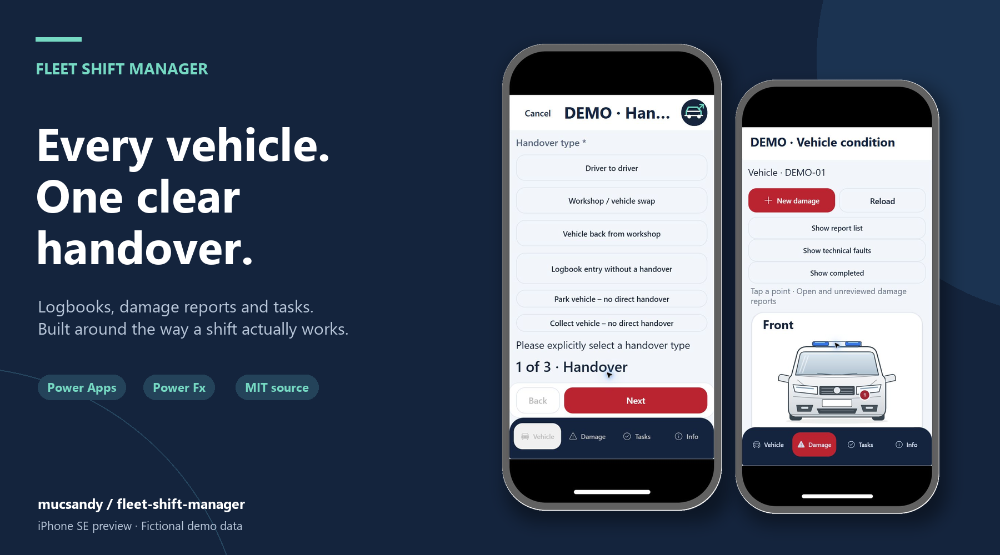

## See the app

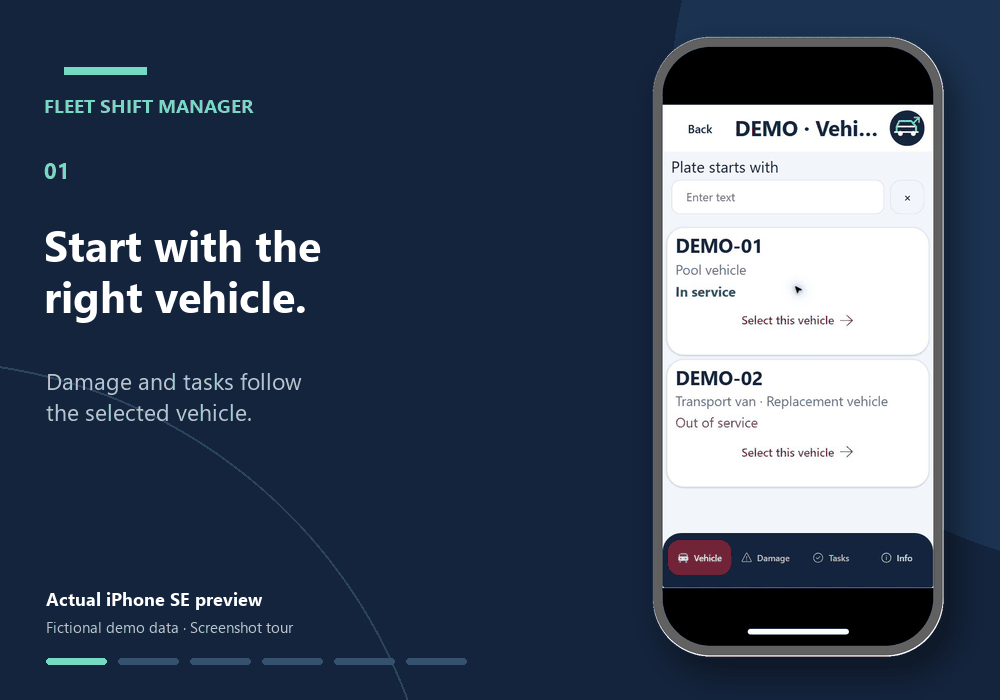

*Actual captures from Power Apps' iPhone SE preview (375 × 667), with fictional demo data. The GIF is a screenshot sequence with presentation transitions, not a performance recording. The sample damage photo is AI-generated and labeled in the app.*

| Start with the right vehicle | Record what actually happened |
| :---: | :---: |
| 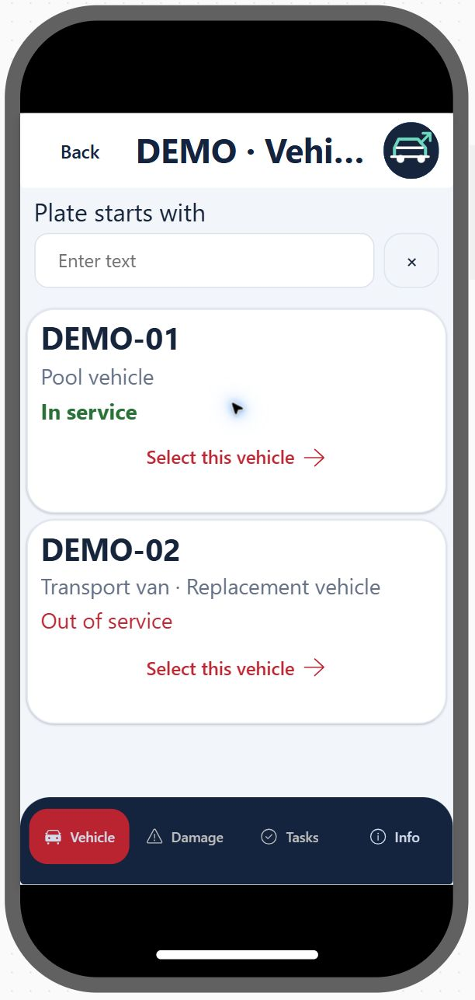 | 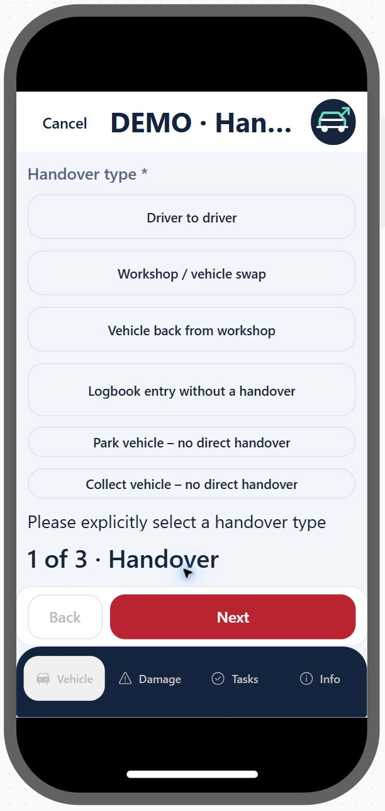 |
| Damage and tasks follow the selected vehicle. | Direct handover, park, collect, logbook entry and workshop journeys. |

| Put damage in the right place | Find the current shift lead |
| :---: | :---: |
| 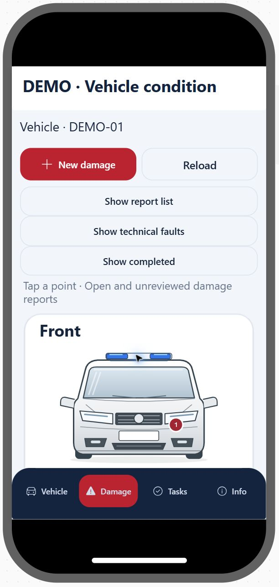 | 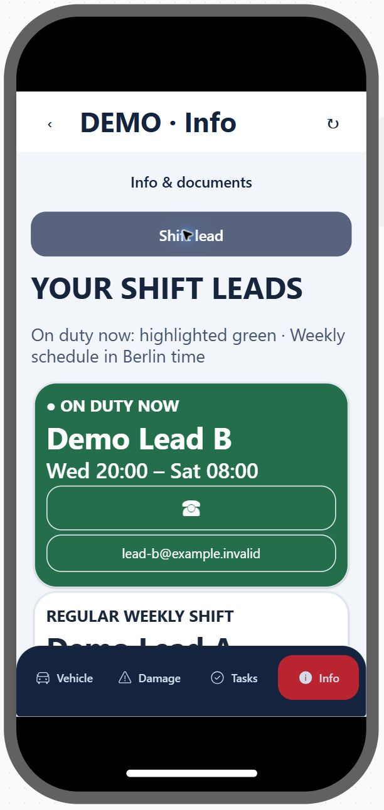 |
| Open a report from its point on the sketch. | Guides and shift leadership have separate views. |

More app screenshots: tasks, guides and damage details

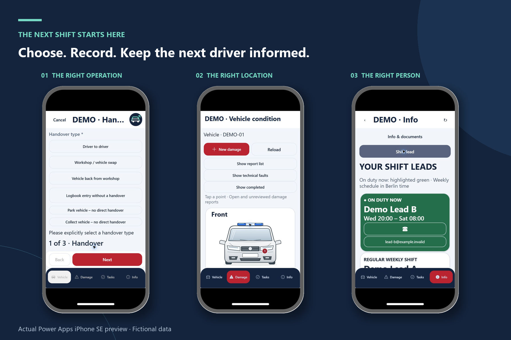

| Due vehicle tasks | Task instructions and documentation |
| :---: | :---: |
| 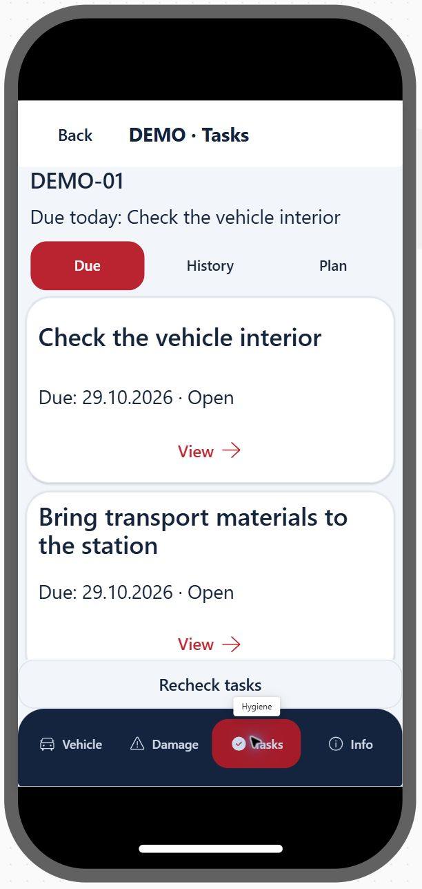 | 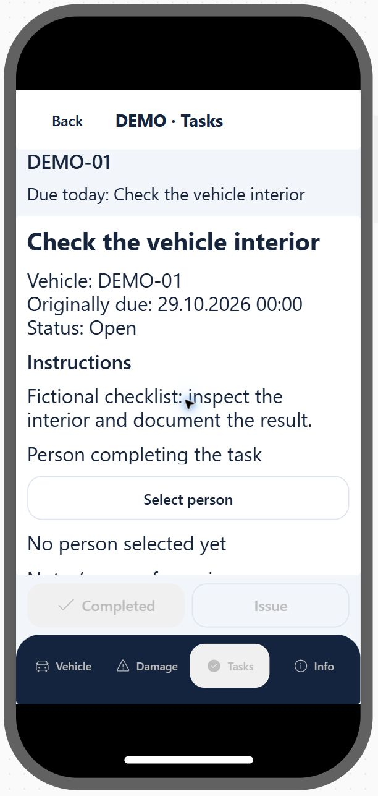 |

| Information and guides | Saved damage details |
| :---: | :---: |
| 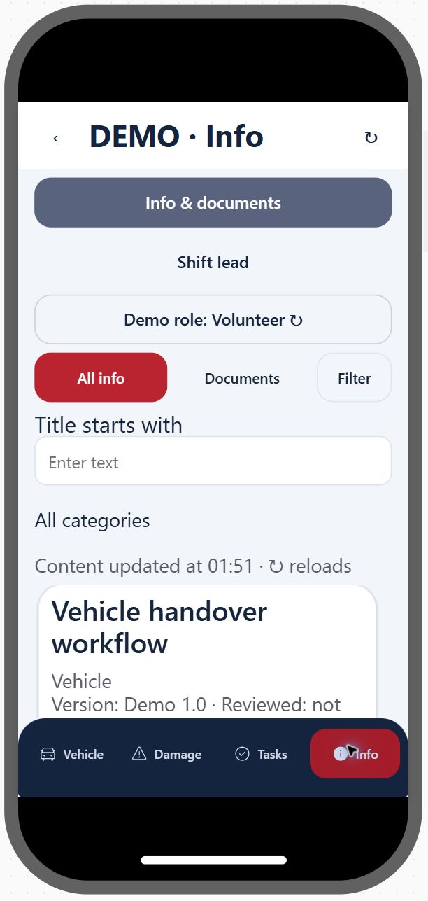 | 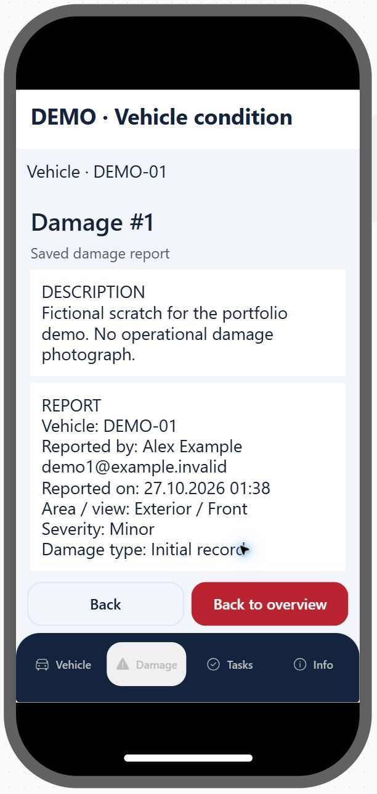 |

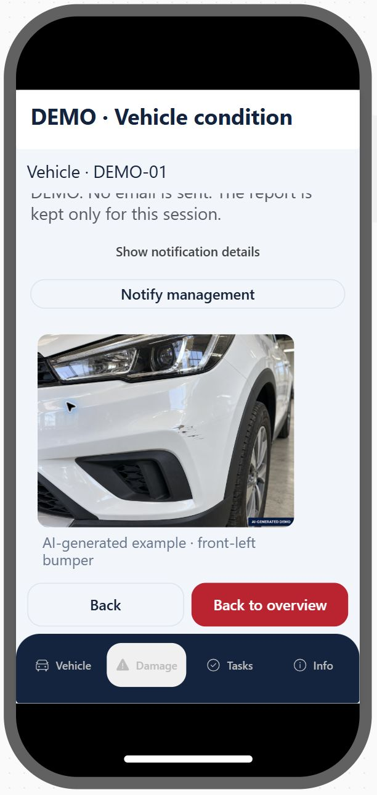

The sample bumper image is artificial, clearly labeled and associated only with the fictional front-left report. It is not an operational damage photograph.

## Why I built it

I wanted the next driver to be able to answer a few simple questions:

**Who last used this vehicle? What condition was it left in? Is there anything I need to deal with before I go?**

The answers were spread across a paper logbook, a folder in the vehicle and handover conversations. I built Fleet Shift Manager to bring that routine into one place, from choosing the vehicle to documenting what happened during the shift.

It grew out of my volunteer work, but the workflow is useful anywhere a team shares vehicles. I'm sharing this anonymized English community edition so other teams can study it, adapt it and save themselves some of the work.

## What the app does

| Workflow | What it brings together |
| --- | --- |
| **Vehicle selection** | Choose the actual vehicle before opening its damage reports or tasks. |
| **Handovers** | Record the people involved, vehicle condition and equipment checks, including cases without an in-person handover. |
| **Digital logbook** | Start/end times, odometer readings, journey details, refueling liters and a signature or explicit name confirmation. |
| **Damage reports** | Put a report on the right point of a vehicle sketch and follow its review status. |
| **Workshop visits** | Handle a workshop drop-off, a replacement vehicle and the return to the original vehicle. |
| **Recurring tasks** | Read instructions, document completion or explain an issue, then keep a readable history. |
| **Shift information** | Separate views for guides and the shift-lead roster, with the current duty period highlighted. |
| **Administration** | Role-dependent screens for people, vehicles, task plans and content. |

Further shift documents are planned for the information area.

## Handovers that fit real life

Sometimes you hand the keys directly to another driver. Sometimes you park the vehicle and leave. Sometimes the next person collects it hours later.

The app makes those different events explicit:

1. **Driver to driver** — a direct handover to another person.
2. **Park vehicle — no direct handover** — leave the vehicle without a recipient present.
3. **Collect vehicle — no direct handover** — pick it up without an in-person giver.
4. **Logbook entry without a handover** — record a journey without transferring the vehicle.
5. **Workshop / vehicle swap** — document the workshop and replacement workflow.
6. **Vehicle back from workshop** — record the original vehicle's return.

A parked vehicle still needs a clear history. The last recorded giver remains available to the next driver even when there was no direct handover.

## A record the next driver can use

Time and odometer checks help catch invalid entries before saving. Refueling can include the amount in liters. The saved logbook details retain the values and confirmation captured for that operation, rather than borrowing the current form draft.

Damage reports link to points on vehicle diagrams, while leadership review and vehicle-release decisions are kept separate from the original report. Recurring tasks bring their instructions and documented outcomes into the same vehicle context.

## The English demo

The demo is a separate Canvas app with seven English screens and nine typed local collections. It uses fictional people, vehicles, tasks and reports.

- Changes last for the current app session.
- There are no business connectors, live directory lookups or email dispatch.
- A role switch lets you explore the leadership and administration views. It is a simulation, not access control.
- Photo uploads are disabled in the disconnected edition. The sample damage photo is AI-generated and clearly labeled.
- Signature drawing and explicit name confirmation are local workflow acknowledgements, not a certified electronic-signature service.

The connected workflow is designed around SharePoint. A real deployment needs its own lists, connections, permissions and attachment handling; the disconnected demo does not test those integrations.

## Setup & release status

**The English session demo and its source are now included.** It runs with fictional local data; you do not need to create lists, configure email or reconnect an organization account to try the workflows.

  <a href="https://github.com/mucsandy/fleet-shift-manager/raw/refs/heads/main/app/Fleet-Shift-Manager-English-Demo.msapp"><strong>Download the Power Apps demo (.msapp)</strong></a> ·
  <a href="docs/INSTALLATION.md">Installation guide</a> ·
  <a href="docs/USER_GUIDE.md">User guide</a> ·
  <a href="docs/VALIDATION.md">What has been tested</a>

1. Download the `.msapp` file above.
2. In [Power Apps](https://make.powerapps.com), choose your development environment, then **Apps → Import app → From file (.msapp)**.
3. Open the downloaded file in Studio, run the app initialization if needed, then preview and select **DEMO-01**.
4. Save it as a new app in your own environment when you want to keep your copy.

You need a Power Apps account, applicable licensing and the **Environment Maker** role in the destination environment. This is a single app file, not a solution ZIP; GitHub's **Download ZIP** is not the file to import. See Microsoft's [single-app import instructions](https://learn.microsoft.com/en-us/power-apps/maker/canvas-apps/export-import-single-app).

**Import checked:** the sanitized file opened in a separate Power Apps Studio session. Vehicle selection, the damage report and embedded sample photo, task-person selection, guides, shift leadership and the simulated role switch passed the import smoke test in iPhone SE preview. Formula checker reported no errors, and the Data pane contained no connected data sources. This is still an early session demo; cross-environment and physical-device tests remain open. See [validation notes](docs/VALIDATION.md).

The [`src-demo`](src-demo) folder contains the nine source files from this export. [`schema/demo-collections.json`](schema/demo-collections.json) describes the nine local tables. See [architecture](docs/ARCHITECTURE.md) and [anonymization](docs/ANONYMIZATION.md) for scope and limitations.

## A few boundaries

The community edition uses invented people and vehicles and contains no operational records or organization branding. This is an independent project.

**A damage entry in the app does not replace the required accident report or your organization's reporting procedure.**

In a connected app, enforce access at the backing data source. Hiding an administration button is not a permission model. Full workshop/replacement regression tests, physical-device checks and a clean-environment installation test remain outstanding.

## Feedback

If your team uses shared vehicles, I'd like to hear which part of the handover is most often missed. Bugs with a clear reproduction, small improvements and examples of other routines are welcome.

[Open an issue](https://github.com/mucsandy/fleet-shift-manager/issues) · [My GitHub profile](https://github.com/mucsandy)

Please use fictional data in public examples. Do not include personal details, real signatures, credentials or operational photographs.

## Buy me a coffee

If this project saves you some work, you can buy me a coffee. It's entirely optional — feedback and sharing the project are appreciated too.

[Support the project via PayPal](https://www.paypal.com/qrcodes/p2pqrc/QCZZ628B4PT2W)

Or scan the PayPal QR code

## License

MIT License — original project work

Copyright (c) 2026 mucsandy

Permission is hereby granted, free of charge, to any person obtaining a copy
of this software and associated documentation files (the "Software"), to deal
in the Software without restriction, including without limitation the rights
to use, copy, modify, merge, publish, distribute, sublicense, and/or sell
copies of the Software, and to permit persons to whom the Software is
furnished to do so, subject to the following conditions:

The above copyright notice and this permission notice shall be included in all
copies or substantial portions of the Software.

THE SOFTWARE IS PROVIDED "AS IS", WITHOUT WARRANTY OF ANY KIND, EXPRESS OR
IMPLIED, INCLUDING BUT NOT LIMITED TO THE WARRANTIES OF MERCHANTABILITY,
FITNESS FOR A PARTICULAR PURPOSE AND NONINFRINGEMENT. IN NO EVENT SHALL THE
AUTHORS OR COPYRIGHT HOLDERS BE LIABLE FOR ANY CLAIM, DAMAGES OR OTHER
LIABILITY, WHETHER IN AN ACTION OF CONTRACT, TORT OR OTHERWISE, ARISING FROM,
OUT OF OR IN CONNECTION WITH THE SOFTWARE OR THE USE OR OTHER DEALINGS IN THE
SOFTWARE.

Microsoft Power Apps and other platform products remain subject to their own terms.
